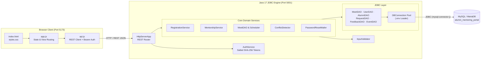
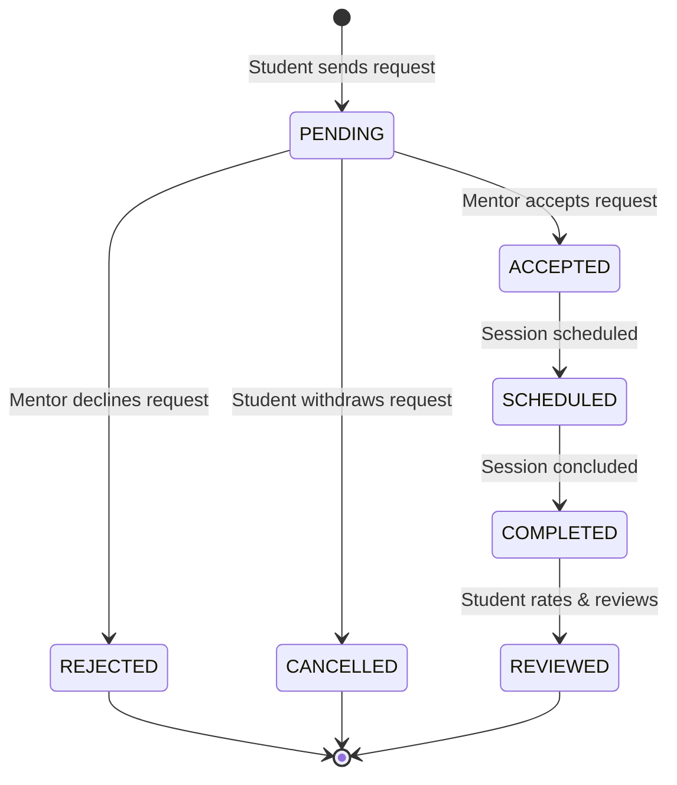
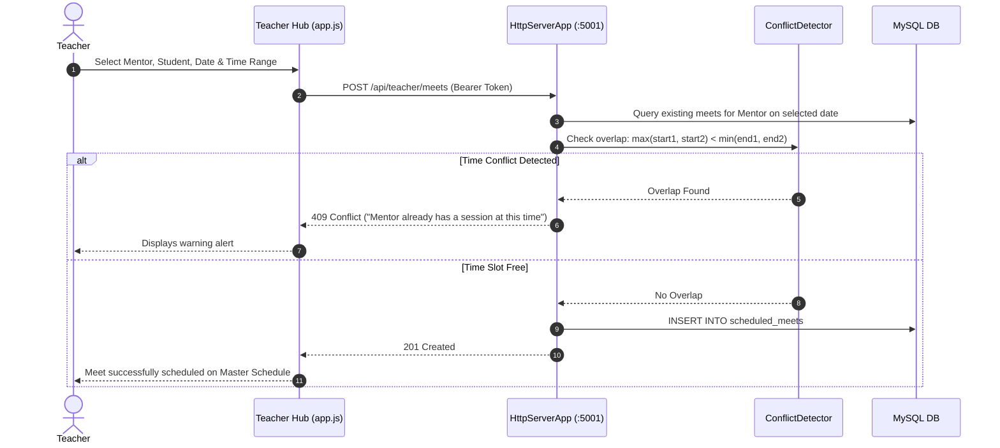
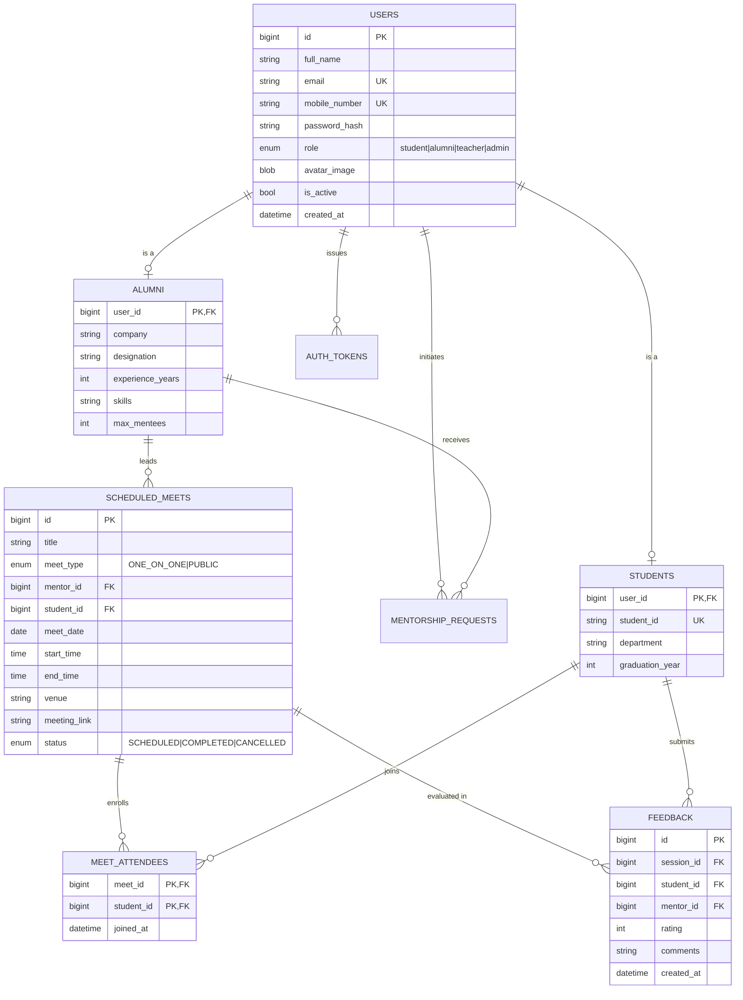

<div align="center">

# AlumniConnect — Alumni Mentoring Portal

**A full-stack, enterprise-grade mentoring platform connecting students with verified industry alumni.**  
Built on a high-performance Java JDBC backend and a clean, responsive Vanilla JavaScript frontend without external framework bloat.

[](https://openjdk.org/)
[](backend/pom.xml)
[](database/)
[](frontend/)
[](backend/src/test/java/com/alumni)
[](LICENSE)

[About](#about) •
[Features by Role](#features-by-role) •
[Architecture](#architecture) •
[Getting Started](#getting-started) •
[Demo Accounts](#demo-accounts) •
[API Reference](#api-reference) •
[Database Design](#database-design) •
[Algorithms](#algorithms-and-data-structures) •
[Testing](#testing)

</div>

---

## About

**AlumniConnect** bridges the gap between college students and experienced graduates across top tech, engineering, and financial firms. The platform streamlines professional discovery, 1-on-1 mentorship requests, scheduling with interval conflict detection, feedback ratings, and institutional coordination.

The system deliberately avoids bulky runtime frameworks (such as Spring or React) to showcase **pure Java networking, robust JDBC transaction handling, hand-written data structures and search algorithms, and responsive vanilla web standards**.

---

## Features by Role

### 1. Student Portal
- **Mentor Discovery & Multi-Field Search**: Search mentors in real time by name, company, job title, skills, or department with telemetry scoring.
- **Mentorship Requests**: Submit requests with specific goals and personal statements. Track lifecycle states (`Pending`, `Accepted`, `Declined`, `Cancelled`).
- **Upcoming & Past Sessions**: View scheduled meetings with live meeting links, completed durations, and session status tracking.
- **Public Masterclasses**: Browse institution-wide public workshops, view live attendee counts and capacity limits, and RSVP with one click.
- **Session Ratings & Feedback**: Submit 1-to-5 star ratings and reviews following completed mentoring sessions.
- **Profile & Avatar Management**: Manage bio, department, and graduation year with direct database BLOB photo streaming.

### 2. Alumni / Mentor Portal
- **Incoming Requests Pipeline**: Review pending student requests, evaluate student notes, and accept or decline requests with personalized feedback.
- **Session Capacity Enforcement**: Automatic server-side enforcement of mentor mentee caps (`max_mentees`).
- **Session Logging**: Track and manage mentoring engagements with duration, topic, and notes.
- **Direct Scheduling**: Connect directly with accepted mentees.

### 3. Faculty / Teacher Hub
- **Mentor Onboarding**: Create and onboard verified alumni mentors directly with industry credentials, capacity, and department associations.
- **1-on-1 Student-Mentor Meets**: Schedule targeted sessions with time interval conflict detection.
- **Public Meets & Masterclasses**: Schedule open group sessions allowing 1 mentor and $N$ students to attend (with optional capacity limits, venue, and meeting links).
- **Master Schedules & Timelines**: Filter and audit scheduled sessions across the institution by type (`1-on-1`, `Public`) and status (`Scheduled`, `Completed`, `Cancelled`).
- **Attendee Roster Inspection**: View complete lists of registered student attendees for any public masterclass.

### 4. System Administration Console
- **Unified User Governance**: View, filter, and manage all accounts across all four roles (`Students`, `Alumni Mentors`, `Faculty Teachers`, `Administrators`).
- **Account State Control**: Instantly activate or deactivate access privileges without data loss.
- **Account Deletion**: Safely delete accounts and cascade-remove associated sessions, tokens, and records.
- **Instant Search**: Search accounts instantly across names, email addresses, and phone numbers.

---

## Architecture



### Technology Stack

| Layer | Technology |
| :--- | :--- |
| **Frontend** | Vanilla HTML5, CSS3 (Custom Design System, Flexbox/Grid), ES6+ JavaScript |
| **Backend Engine** | Java 17, `com.sun.net.httpserver`, Raw TCP Socket Server, Apache Maven |
| **Data Access** | Raw JDBC with `mysql-connector-j 9.2.0`, PreparedStatements, Transactions |
| **Database** | MySQL 8.0+ / MariaDB 10.5+ (InnoDB engine, Foreign Keys, Unique Indexes) |
| **Security** | Salted SHA-256 hashing, SHA-256 hashed bearer tokens in database, Role-Based Access Control |
| **Testing** | JUnit 5 (`junit-jupiter 5.11`) — 173 automated tests |

---

## Workflows

### 1. Mentorship Request Lifecycle



### 2. Teacher Scheduling & Conflict Detection



---

## Getting Started

### Prerequisites
- **JDK 17 or higher**
- **Apache Maven 3.8+**
- **MySQL 8.0+** or **MariaDB 10.5+**
- **Node.js** (for running the dev server via `npm run dev`) or Python 3 (`python3 -m http.server`)

---

### Step 1: Clone the Repository

```bash
git clone https://github.com/anuragpatil1729/Alumni-Mentoring-Portal.git
cd Alumni-Mentoring-Portal
```

---

### Step 2: Database Setup

Ensure MySQL or MariaDB is running on your machine:

```bash
# macOS (Homebrew)
brew services start mariadb   # or: brew services start mysql

# Create database and apply baseline schema
mysql -u root -p -e "CREATE DATABASE IF NOT EXISTS alumni_mentoring_portal;"
mysql -u root -p alumni_mentoring_portal < database/schema.sql

# Run all migrations in order
for file in database/migrations/*.sql; do
  echo "Applying $file..."
  mysql -u root -p alumni_mentoring_portal < "$file"
done

# Seed initial accounts and demo mentors
mysql -u root -p alumni_mentoring_portal < database/seed.sql
```

---

### Step 3: Configure Backend Environment

Create a `.env` file inside the `backend/` directory:

```bash
cp backend/.env.example backend/.env
```

Edit `backend/.env` with your local database credentials:

```env
DB_HOST=localhost
DB_PORT=3306
DB_NAME=alumni_mentoring_portal
DB_USER=root
DB_PASSWORD=your_password
PORT=5001

# Optional: SMTP Configuration for password resets
SMTP_HOST=smtp.gmail.com
SMTP_PORT=587
SMTP_USERNAME=your_email@college.edu
SMTP_PASSWORD=your_app_password
SMTP_FROM=no-reply@college.edu
```

---

### Step 4: Run the Backend Server

```bash
cd backend
mvn compile exec:java
```

- **REST API**: `http://localhost:5001`
- **Health Check**: `http://localhost:5001/api/health`
- **Socket Server**: `localhost:5002`

---

### Step 5: Run the Frontend

In a separate terminal window:

```bash
cd frontend
npm run dev
```

Visit **http://localhost:5173** in your web browser.

---

## Demo Accounts

All accounts are pre-seeded via [`database/seed.sql`](database/seed.sql):

| Role | Email | Password | Primary Features |
| :--- | :--- | :--- | :--- |
| **Student** | `rahul.student@college.edu` | `Password@123` | Search mentors, send requests, RSVP to public meets |
| **Student** | `ananya.p@college.edu` | `Password@123` | Explore directory, submit session feedback |
| **Alumni Mentor** | `anurag.patil@microsoft.com` | `Alumni@123` | Manage mentee requests, review session schedule |
| **Alumni Mentor** | `rohanmali@google.com` | `Alumni@123` | Accept requests, conduct 1-on-1 guidance |
| **Faculty Teacher** | `teacher.sharma@college.edu` | `Password@123` | Onboard mentors, schedule 1-on-1 & public meets |
| **Administrator** | `admin@college.edu` | `Admin@123` | Governance, role filters, deactivate/delete accounts |

---

## API Reference

All REST endpoints run on `http://localhost:5001`. Authenticated requests require the header:  
`Authorization: Bearer <token>`.

### Authentication & Users
| Method | Endpoint | Description | Auth Required |
| :--- | :--- | :--- | :---: |
| `POST` | `/api/auth/login` | Authenticate user, return bearer token and role | No |
| `POST` | `/api/auth/logout` | Revoke current bearer token | Yes |
| `POST` | `/api/auth/register/student` | Register a new student account | No |
| `POST` | `/api/auth/register/alumni` | Register a new alumni mentor | No |
| `GET` | `/api/auth/check-availability` | Check real-time email / mobile availability | No |
| `POST` | `/api/auth/password-strength` | Evaluate password complexity score (0–4) | No |
| `GET` / `PUT` | `/api/profile` | Read or update current user profile | Yes |
| `GET` / `POST` | `/api/users/{id}/avatar` | Stream avatar image or upload new picture (`MEDIUMBLOB`) | Public / Yes |

### Mentors & Requests
| Method | Endpoint | Description | Auth Required |
| :--- | :--- | :--- | :---: |
| `GET` | `/api/mentors` | Fetch all approved alumni mentors | Public |
| `GET` | `/api/mentors/search` | Search mentors by query, department, industry, and experience | Public |
| `POST` | `/api/requests` | Submit a new mentorship request to an alumni mentor | Student |
| `GET` | `/api/requests` | Fetch mentorship requests (`studentId` or `mentorId`) | Yes |
| `PUT` | `/api/requests` | Update request status (`ACCEPTED`, `REJECTED`, `CANCELLED`) | Yes |

### Teacher Hub & Public Meets
| Method | Endpoint | Description | Auth Required |
| :--- | :--- | :--- | :---: |
| `GET` | `/api/teacher/mentors` | Retrieve mentor list for teacher scheduling dropdowns | Teacher |
| `GET` | `/api/teacher/students` | Retrieve student list for teacher scheduling dropdowns | Teacher |
| `POST` | `/api/teacher/mentors` | Onboard a new alumni mentor directly into the system | Teacher |
| `POST` | `/api/teacher/meets` | Create a 1-on-1 meet or public masterclass with conflict detection | Teacher |
| `GET` | `/api/teacher/meets` | Retrieve all scheduled meets with type and status filters | Teacher |
| `PATCH`| `/api/teacher/meets/{id}/status` | Mark a scheduled meet as `COMPLETED` or `CANCELLED` | Teacher |
| `GET` | `/api/teacher/meets/{id}/attendees` | Fetch roster of student attendees for a public meet | Teacher |
| `GET` | `/api/meets/public` | Retrieve upcoming public masterclasses | Student / Public |
| `POST` | `/api/meets/{id}/register` | Student RSVP / registration for a public masterclass | Student |
| `POST` | `/api/meets/{id}/unregister` | Student un-registration from a public masterclass | Student |

### Admin Console
| Method | Endpoint | Description | Auth Required |
| :--- | :--- | :--- | :---: |
| `GET` | `/api/admin/users` | List all system accounts with role and status filtering | Admin |
| `PATCH`| `/api/admin/users/{id}/status` | Toggle user active state (`active: true / false`) | Admin |
| `DELETE`| `/api/admin/users/{id}` | Permanently delete a user account and associated records | Admin |

---

## Database Design

### Entity Relationship Model



### Database Migration Sequence
1. [`001_auth_and_roles.sql`](database/migrations/001_auth_and_roles.sql): User roles, active flags, and auth token storage.
2. [`002_events_and_opportunities.sql`](database/migrations/002_events_and_opportunities.sql): Campus events and career opportunity postings.
3. [`003_teacher_assignments_and_marks.sql`](database/migrations/003_teacher_assignments_and_marks.sql): Faculty event assignments and evaluations.
4. [`004_alumni_slot_bookings.sql`](database/migrations/004_alumni_slot_bookings.sql): Booking slots for guest alumni.
5. [`005_password_resets_and_session_history.sql`](database/migrations/005_password_resets_and_session_history.sql): Password reset tokens and session execution histories.
6. [`006_feedback.sql`](database/migrations/006_feedback.sql): Mentorship ratings, feedback entries, and session metrics.
7. [`007_teacher_meets_and_schedules.sql`](database/migrations/007_teacher_meets_and_schedules.sql): Teacher scheduling system, 1-on-1 meets, public masterclasses, and attendee rosters.

---

## Algorithms and Data Structures

All searching, sorting, and interval algorithms are implemented from first principles in pure Java without third-party utility libraries:

| Class | Algorithm | Details | Complexity |
| :--- | :--- | :--- | :--- |
| [`SearchAlgorithms`](backend/src/main/java/com/alumni/search/SearchAlgorithms.java) | **Multi-Token Linear Search** | Scans multiple candidate fields with weighted token relevance scoring | $\mathcal{O}(n)$ |
| [`SearchAlgorithms`](backend/src/main/java/com/alumni/search/SearchAlgorithms.java) | **Quicksort + Binary Search** | In-place partitioning with dual-pointer boundary expansion for duplicate matches | $\mathcal{O}(n \log n) + \mathcal{O}(\log n)$ |
| [`SessionSorter`](backend/src/main/java/com/alumni/search/SessionSorter.java) | **Insertion, Selection, & Bubble Sort** | Multi-attribute sorting by session date, duration, priority, and severity | $\mathcal{O}(n^2)$ |
| [`ConflictDetector`](backend/src/main/java/com/alumni/service/ConflictDetector.java) | **Interval Overlap Verification** | Evaluates time-slot collisions: $\max(s_1, s_2) < \min(e_1, e_2)$ | $\mathcal{O}(1)$ |

Every search query response includes automated telemetry tracking:
- `comparisonCount`: Number of comparisons executed.
- `executionTimeNs`: Total search latency in nanoseconds.

---

## Testing

The backend includes a comprehensive automated test suite of **173 tests** covering integration, validation, security boundaries, and data access.

```bash
cd backend
mvn test
```

### Test Suite Breakdown

| Test Suite | Tests | Scope |
| :--- | :---: | :--- |
| `ValidationTest` | 28 | Email format, mobile normalization, name validation, password strength scoring |
| `LoginBoundaryTest` | 26 | Boundary values, SQL injection resistance, payload fuzzing, Unicode resilience |
| `MentorshipRequestTest` | 23 | Request lifecycle, duplicate prevention, self-request blocks, mentee cap enforcement |
| `SearchAlgorithmsTest` | 19 | Linear vs binary search accuracy, quicksort stability, telemetry reporting |
| `AuthProfileIntegrationTest` | 16 | Complete registration ➔ login ➔ profile update ➔ avatar streaming pipeline |
| `ProfileTest` | 13 | Avatar binary storage, content-type detection, profile data updates |
| `AdminRoleAccessTest` | 13 | Administrator access controls, user activation toggling, cascading account deletion |
| `SessionFeedbackIntegrationTest` | 11 | Post-session rating submissions, 1–5 score validation, feedback queries |
| `ConflictDetectionTest` | 9 | Interval overlaps, exact containment, edge-boundary sharing, zero-length intervals |
| `SessionHistorySortTest` | 7 | Multi-criterion sorting accuracy across dates, durations, and priorities |
| `PasswordResetAndTeacherTest` | 4 | Password reset token flows and teacher schedule authorization |
| `JDBCTest` | 4 | Connection validation, pool stability, transaction rollbacks |
| **Total** | **173** | **100% Passing (0 Failures)** |

---

## Project Structure

```text
Alumni-Mentoring-Portal/
├── backend/                              # Java 17 Backend Engine
│   ├── pom.xml                           # Maven dependencies & build configuration
│   ├── .env.example                      # Template environment variables
│   └── src/
│       ├── main/java/com/alumni/
│       │   ├── Main.java                 # Entrypoint: launches HTTP & Socket servers
│       │   ├── config/                   # DBConnection & configuration loader
│       │   ├── server/                   # HttpServerApp router & HttpUtils helpers
│       │   ├── security/                 # AuthService, token issuance & hashing
│       │   ├── service/                  # Registration, Mentorship, ConflictDetector, Mailer
│       │   ├── dao/                      # JDBC Data Access Objects (MeetDAO, UserDAO, etc.)
│       │   ├── model/                    # Domain models (User, Student, Alumni, ScheduledMeet)
│       │   ├── search/                   # Hand-written search & sorting algorithms
│       │   └── validation/               # InputValidator & regex patterns
│       └── test/java/com/alumni/         # 12 JUnit 5 integration & unit test suites
├── frontend/                             # Vanilla Web Frontend
│   ├── index.html                        # Application interface & all view sections
│   ├── css/
│   │   └── styles.css                    # Responsive design system & component styles
│   └── js/
│       ├── api.js                        # Promise-based REST client with Bearer auth
│       └── app.js                        # State management, view router & event handlers
├── database/                             # Database Schema & Migrations
│   ├── schema.sql                        # Base relational schema
│   ├── migrations/                       # Incremental migrations 001 through 007
│   ├── seed.sql                          # Seed data with demo accounts
│   └── stored_database.sql               # Snapshot dump for fast import
└── docs/                                 # Technical documentation & architecture diagrams
```

---

## License

This project is licensed under the [MIT License](LICENSE).
