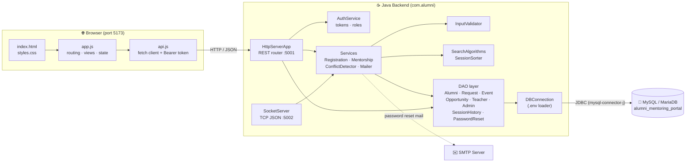
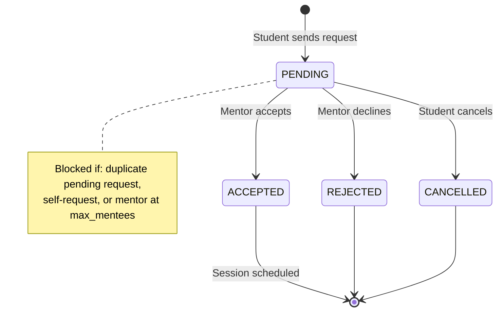
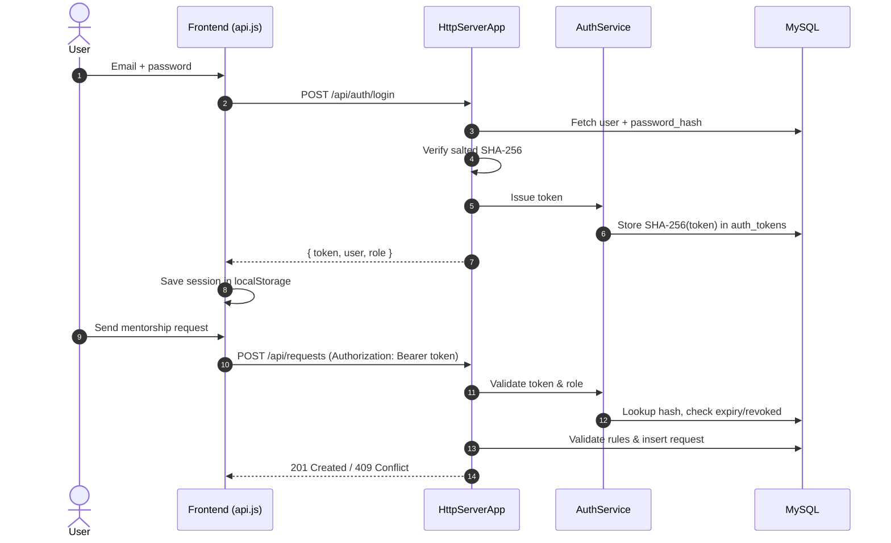
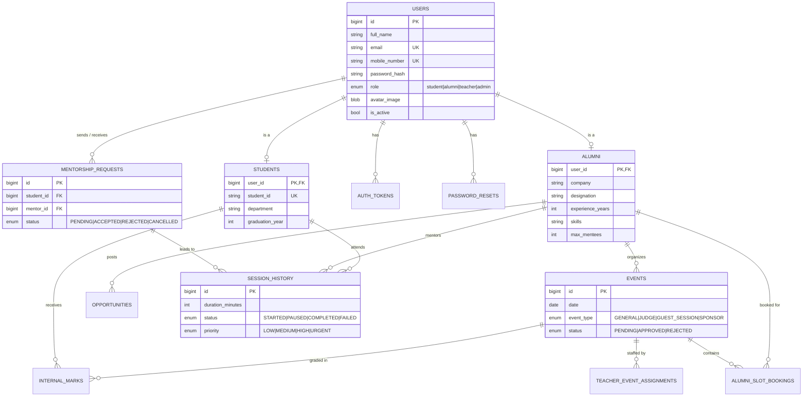

<div align="center">

# 🎓 AlumniConnect — Alumni Mentoring Portal

**A full-stack mentorship platform that connects students with verified industry alumni —
built on a pure Java JDBC backend and a zero-framework Vanilla JS frontend.**

[](https://openjdk.org/)
[](backend/pom.xml)
[](database/)
[](frontend/)
[](backend/src/test/java/com/alumni)
[](LICENSE)

[Features](#-features) •
[Architecture](#-architecture) •
[Getting Started](#-getting-started) •
[API](#-api-overview) •
[Database](#-database-design) •
[Testing](#-testing) •
[Docs](#-documentation)

</div>

---

## 📖 About

**AlumniConnect** lets students discover alumni mentors, send 1-on-1 mentorship requests, schedule
sessions and track their history — while alumni, teachers and admins manage events,
opportunities, approvals and evaluations from role-specific dashboards.

The project deliberately avoids heavy frameworks (no Spring, no React) to showcase
**core Java networking, JDBC, hand-written DSA algorithms and vanilla web fundamentals**.

---

## ✨ Features

| Area | Highlights |
| :--- | :--- |
| 🔐 **Auth & Security** | Salted SHA-256 password hashing · Bearer tokens (hashed in `auth_tokens`) · Logout/revocation · Email-based password reset over SMTP · Role-based access control |
| 👥 **4 User Roles** | `STUDENT`, `ALUMNI`, `TEACHER`, `ADMIN` — each with its own dashboard and server-enforced permissions |
| 📝 **Registration** | Separate student / alumni flows · Live email & mobile availability check · Real-time name validation · 4-segment password strength meter (+ REST API) |
| 🔍 **Mentor Directory** | Debounced search across name, company, skills, department · Filters (department, industry, experience) · Search telemetry (comparisons, latency) |
| 📬 **Mentorship Requests** | `PENDING → ACCEPTED / REJECTED / CANCELLED` lifecycle · Duplicate & self-request protection · Mentor capacity (`max_mentees`) enforcement |
| 📅 **Session Scheduling** | Schedule with a mentor by date/time · Manual interval **conflict detection** |
| 🕘 **Session History** | Track `STARTED / PAUSED / COMPLETED / FAILED` sessions · Sort by date, duration, priority or severity using hand-written sorting algorithms |
| 🎤 **Events** | Alumni create events (General, Judge, Guest Session, Sponsor) · Admin approval workflow |
| 💼 **Opportunities** | Alumni post jobs/internships with deadline, eligibility & application link |
| 🧑‍🏫 **Teacher Tools** | Event assignments (coordinator / evaluator / supervisor) · Alumni slot bookings · Internal marks entry |
| 🖼️ **Profiles & Avatars** | Editable profiles · Avatars stored as `MEDIUMBLOB` and streamed via `/api/users/{id}/avatar` |

---

## 🏗 Architecture



### Tech Stack

| Layer | Technology |
| :--- | :--- |
| **Frontend** | HTML5, Vanilla CSS3, ES6 JavaScript — no build step |
| **Backend** | Java 17, `com.sun.net.httpserver`, raw TCP sockets, Maven |
| **Libraries** | `mysql-connector-j 9.2.0`, `org.json`, `angus-mail` (SMTP) |
| **Database** | MySQL 8+ / MariaDB 10.5+ (InnoDB, FKs, CHECK constraints) |
| **Testing** | JUnit 5 (`junit-jupiter 5.11`) |

---

## 🔄 Key Flows

### Mentorship Request Lifecycle



### Authentication & Authorized Request



---

## 🚀 Getting Started

### Prerequisites

- **JDK 17+** and **Maven 3.8+**
- **MySQL 8+** or **MariaDB 10.5+**
- **Node.js** (optional — only for `npm run dev`; Python's `http.server` works too)

### 1️⃣ Clone

```bash
git clone https://github.com/anuragpatil1729/Alumni-Mentoring-Portal.git
cd Alumni-Mentoring-Portal
```

### 2️⃣ Set up the database

```bash
# Start the DB service (macOS / Homebrew)
brew services start mysql        # or: brew services start mariadb

# Base schema
mysql -u root -p < database/schema.sql

# Migrations — run in order
for f in database/migrations/00*.sql; do mysql -u root -p alumni_mentoring_portal < "$f"; done

# Demo data
mysql -u root -p alumni_mentoring_portal < database/seed.sql
```

> 💡 `database/stored_database.sql` is a lightweight snapshot dump of the base tables and seed data.

### 3️⃣ Configure the backend

```bash
cp backend/.env.example backend/.env
```

```env
DB_HOST=localhost
DB_PORT=3306
DB_NAME=alumni_mentoring_portal
DB_USER=root
DB_PASSWORD=your_password
PORT=5001

# Optional — required only for password-reset emails
SMTP_HOST=smtp.gmail.com
SMTP_PORT=587
SMTP_USERNAME=you@example.com
SMTP_PASSWORD=app_password
SMTP_FROM=you@example.com
```

> Defaults also live in [`application.properties`](backend/src/main/resources/application.properties) (HTTP `5001`, TCP socket `5002`).

### 4️⃣ Run the backend

```bash
cd backend
mvn compile exec:java
```

✅ REST API → `http://localhost:5001` (health check: `/api/health`)
✅ TCP socket → `localhost:5002`

### 5️⃣ Run the frontend

```bash
cd frontend
npm run dev                      # or: python3 -m http.server 5173
```

Open **http://localhost:5173** 🎉

---

## 🔑 Demo Accounts

Loaded by [`seed.sql`](database/seed.sql):

| Role | Email | Password |
| :--- | :--- | :--- |
| Student | `rahul.student@college.edu` | `Student@123` |
| Student | `ananya.p@college.edu` | `Student@123` |
| Alumni | `anurag.patil@microsoft.com` | `Alumni@123` |
| Alumni | `rohanmali@google.com` | `Alumni@123` |
| Alumni | `priya.sharma@amazon.com` | `Alumni@123` |
| Teacher | `teacher.sharma@college.edu` | `Teacher@123` |
| Admin | `admin@college.edu` | `Admin@123` |

> Ten alumni mentors are seeded in total (Microsoft, Google, Amazon, Nvidia, Goldman Sachs, Deloitte, Apple, Meta, McKinsey).

---

## 📡 API Overview

All endpoints are served from `http://localhost:5001`. Protected routes require
`Authorization: Bearer <token>`. Full reference → [`docs/API_Documentation.md`](docs/API_Documentation.md).

<details>
<summary><b>🔐 Auth & Registration</b></summary>

| Method | Endpoint | Description |
| :--- | :--- | :--- |
| `POST` | `/api/auth/login` | Log in, returns token |
| `POST` | `/api/auth/logout` | Revoke current token |
| `POST` | `/api/auth/register/student` | Register a student |
| `POST` | `/api/auth/register/alumni` | Register an alumni mentor |
| `GET` | `/api/auth/check-availability` | Check email / mobile availability |
| `POST` | `/api/auth/password-strength` | Score a password (0–4) |
| `POST` | `/api/auth/password-reset/request` | Email a reset link |
| `POST` | `/api/auth/password-reset/confirm` | Set new password with token |
| `GET` | `/api/auth/registrations/{email}` | Look up own registration |
| `POST` | `/api/servlet/register`, `/cgi-bin/register` | Servlet / CGI-style registration |
| `TCP` | `localhost:5002` | Newline-delimited JSON registration |

</details>

<details>
<summary><b>🔍 Mentors, Profiles & Avatars</b></summary>

| Method | Endpoint | Description |
| :--- | :--- | :--- |
| `GET` | `/api/mentors` | List all mentors |
| `GET` | `/api/mentors/{id}` | Mentor details |
| `GET` | `/api/mentors/search` | Search with `query`, `department`, `industry`, `minExperience` |
| `GET` / `PUT` | `/api/profile` | View / update own profile |
| `GET` / `HEAD` | `/api/users/{id}/avatar` | Stream avatar (public) |
| `POST` / `PUT` / `DELETE` | `/api/users/{id}/avatar` | Manage avatar (owner / admin) |

</details>

<details>
<summary><b>📬 Requests & Sessions</b></summary>

| Method | Endpoint | Description |
| :--- | :--- | :--- |
| `POST` | `/api/requests` | Create mentorship request |
| `GET` | `/api/requests?studentId=` / `?mentorId=` | List requests |
| `PUT` | `/api/requests?id=` | Accept / reject / cancel |
| `POST` | `/api/session-history` | Log a session |
| `GET` | `/api/session-history` | List & sort sessions |
| `PATCH` | `/api/session-history/{id}/status` | Update session status |

</details>

<details>
<summary><b>🎤 Events, Opportunities, Teacher & Admin</b></summary>

| Method | Endpoint | Description |
| :--- | :--- | :--- |
| `GET` / `POST` | `/api/events` | Browse / create events |
| `GET` / `POST` | `/api/opportunities` | Browse / post opportunities |
| `*` | `/api/admin/events/{id}` | Approve / reject events (admin) |
| `*` | `/api/admin/users` | Manage users (admin) |
| `GET` | `/api/teacher/events` | Teacher's assigned events |
| `GET` / `POST` | `/api/teacher/bookings` | Alumni slot bookings |
| `PATCH` | `/api/teacher/bookings/{id}/status` | Update booking status |
| `POST` / `PUT` | `/api/teacher/events/{id}/marks[/{studentId}]` | Enter / edit internal marks |

</details>

---

## 🗄 Database Design



| Migration | Adds |
| :--- | :--- |
| [`001_auth_and_roles`](database/migrations/001_auth_and_roles.sql) | `teacher`/`admin` roles, `is_active`, `auth_tokens` |
| [`002_events_and_opportunities`](database/migrations/002_events_and_opportunities.sql) | `events`, `opportunities` |
| [`003_teacher_assignments_and_marks`](database/migrations/003_teacher_assignments_and_marks.sql) | `teacher_event_assignments`, `internal_marks` |
| [`004_alumni_slot_bookings`](database/migrations/004_alumni_slot_bookings.sql) | `alumni_slot_bookings` |
| [`005_password_resets_and_session_history`](database/migrations/005_password_resets_and_session_history.sql) | `password_resets`, `session_history` |

A rendered ER diagram is also available at [`docs/ER_Diagram.png`](docs/ER_Diagram.png).

---

## 🧠 Algorithms (Hand-Written, No Library Sorting)

| Component | Algorithm | Complexity |
| :--- | :--- | :--- |
| [`SearchAlgorithms`](backend/src/main/java/com/alumni/search/SearchAlgorithms.java) | Multi-field **linear search** with token scoring | `O(n)` |
| | **Quicksort + binary search** with boundary expansion for duplicates/prefixes | `O(n log n) + O(log n)` |
| [`SessionSorter`](backend/src/main/java/com/alumni/search/SessionSorter.java) | **Insertion / Selection / Bubble sort** by date, duration, priority, severity | `O(n²)` |
| [`ConflictDetector`](backend/src/main/java/com/alumni/service/ConflictDetector.java) | Interval overlap: conflict ⇔ `max(s₁, s₂) < min(e₁, e₂)` | `O(1)` per pair |

Every search/sort response includes **telemetry** — comparison count and execution time (`System.nanoTime()`).

---

## 📁 Project Structure

```text
Alumni-Mentoring-Portal/
├── backend/                      # Java 17 + Maven
│   ├── pom.xml
│   ├── .env.example
│   └── src/
│       ├── main/java/com/alumni/
│       │   ├── Main.java         # Boots HTTP (5001) + TCP (5002) servers
│       │   ├── config/           # DBConnection (.env / properties loader)
│       │   ├── server/           # HttpServerApp (router), HttpUtils (CORS/JSON)
│       │   ├── security/         # AuthService, AuthenticatedUser, AuthException
│       │   ├── service/          # Registration, Mentorship, ConflictDetector, Mailer, SocketServer
│       │   ├── dao/              # JDBC data-access objects (10 DAOs)
│       │   ├── model/            # User, Student, Alumni, MentorshipRequest
│       │   ├── search/           # SearchAlgorithms, SessionSorter, SearchResult
│       │   └── validation/       # InputValidator, ValidationConstants, ValidationResult
│       └── test/java/com/alumni/ # 9 JUnit 5 suites
├── frontend/                     # Vanilla HTML / CSS / JS
│   ├── index.html
│   ├── css/styles.css
│   └── js/{api.js, app.js}
├── database/
│   ├── schema.sql                # Base tables
│   ├── migrations/               # 001 → 005 incremental migrations
│   ├── seed.sql                  # Demo users, alumni, students, admin, teacher
│   └── stored_database.sql       # Snapshot dump
├── docs/                         # API, testing, flows, ER diagram
├── images/                       # Sample avatar images
└── LICENSE
```

---

## 🧪 Testing

```bash
cd backend
mvn clean test
```

> ⚠️ Integration suites need the database running with the schema, migrations and seed applied.

| Suite | Tests | Covers |
| :--- | :---: | :--- |
| `ValidationTest` | 28 | Email, mobile, name, password strength, student ID, registration endpoints |
| `LoginBoundaryTest` | 26 | Boundary values, max lengths, SQL-injection resilience, unicode |
| `MentorshipRequestTest` | 23 | Lifecycle, duplicates, self-requests, capacity, `/api/requests` |
| `SearchAlgorithmsTest` | 19 | Linear vs binary search, quicksort, telemetry |
| `AuthProfileIntegrationTest` | 16 | Register → login → profile → avatar → search (end-to-end) |
| `ProfileTest` | 13 | Avatar upload/retrieval, MIME types, profile updates |
| `ConflictDetectionTest` | 9 | Overlaps, containment, shared boundaries, zero-length slots |
| `SessionHistorySortTest` | 7 | Sorting accuracy across all criteria |
| `JDBCTest` | 4 | Connectivity and CRUD |
| **Total** | **145** | ✅ `BUILD SUCCESS` |

Detailed report → [`docs/test-docs/Testing_Report.md`](docs/test-docs/Testing_Report.md)

---

## 📚 Documentation

| Document | Description |
| :--- | :--- |
| [API_Documentation.md](docs/API_Documentation.md) | Full REST API reference |
| [SEARCH_LIFECYCLE.md](docs/SEARCH_LIFECYCLE.md) | Search engine flow & algorithms |
| [STATUS_TRACKING_FLOW.md](docs/STATUS_TRACKING_FLOW.md) | Request/session status state machine |
| [WEEK_8_ALL_TEAMS_DELIVERY.md](docs/WEEK_8_ALL_TEAMS_DELIVERY.md) | Sprint delivery report |
| [Testing_Report.md](docs/test-docs/Testing_Report.md) | Boundary & integration testing |
| [backend/README.md](backend/README.md) | Backend-specific notes |

---

## 🤝 Contributing

1. Fork the repo and create a branch: `git checkout -b feature/my-feature`
2. Add any schema changes as a **new numbered migration** in `database/migrations/`
3. Make sure `mvn clean test` passes
4. Open a pull request with a clear description

> 🔒 Never commit `backend/.env` — it is already in `.gitignore`.

---

## 📄 License

Released under the [MIT License](LICENSE).
