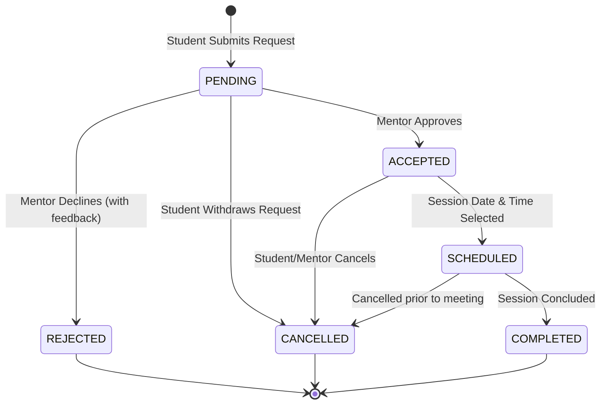
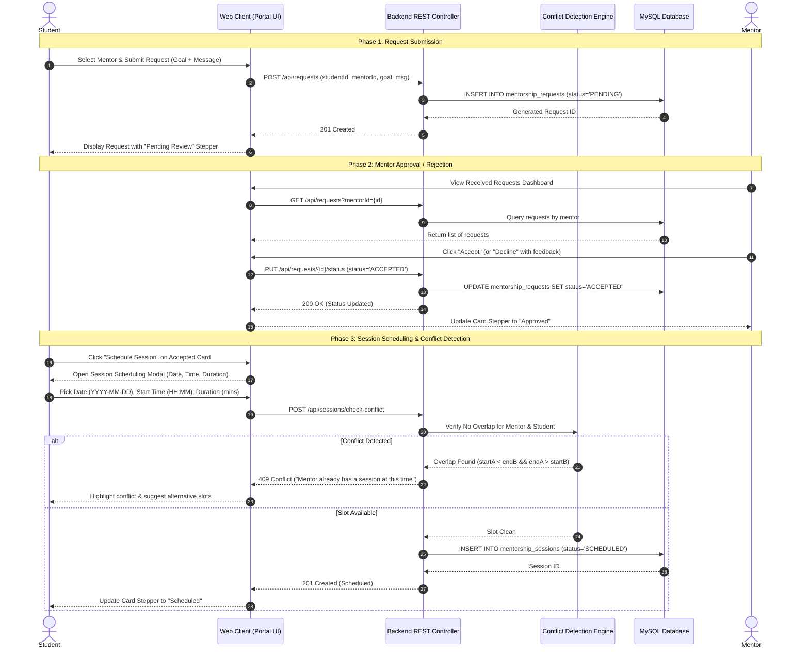

# Mentorship Request & Session Status Tracking Flow
**Alumni Mentoring Portal — Architecture & Design Specification**
*Team 1: Status Tracking Lifecycle & Session Scheduling Architecture*

---

## 1. Executive Summary

This document specifies the complete **Status Tracking Flow** and **Session Scheduling Architecture** for the Alumni Mentoring Portal. The lifecycle governs how mentorship engagements progress from the initial student inquiry through mentor review, status determination, 1-on-1 session scheduling, and final completion.

---

## 2. Status Lifecycle State Machine

The mentorship request progresses through well-defined states. The transition model enforces strict state guards preventing invalid progressions or race conditions.



### State Definitions

| State | Scope | Description |
|:---|:---|:---|
| `PENDING` | Request | The student has drafted and submitted a formal mentorship request. Awaiting alumni mentor review. |
| `ACCEPTED` | Request | The mentor has reviewed the student's profile and learning goals and accepted the connection. Unlocks session scheduling. |
| `REJECTED` | Request (Terminal) | The mentor declined the request with structured feedback (e.g., domain mismatch, capacity limits). |
| `CANCELLED` | Request / Session (Terminal) | The student withdrew the pending request or either party cancelled before execution. |
| `SCHEDULED` | Session | Mentor or student scheduled a specific date, start/end time, and meeting medium (Google Meet / Zoom / In-Person). |
| `COMPLETED` | Session (Terminal) | The mentorship session took place successfully. |

---

## 3. End-to-End Sequence Diagram



---

## 4. Visual Status Tracking Flow in UI

The portal UI presents a modern **4-Step Visual Stepper** directly on each request card:

```
[ Step 1: Sent ]  ════>  [ Step 2: Under Review ]  ════>  [ Step 3: Approved ]  ════>  [ Step 4: Scheduled / Done ]
    ● (Completed)             ● (Active / Completed)           ● (Pending / Done)            ○ (Upcoming)
```

- **Step 1 — Request Sent**: Validated timestamp when the student sent the initial mentorship inquiry.
- **Step 2 — Under Review**: Indicator showing mentor notification and deliberation.
- **Step 3 — Approved**: Highlights mentor acceptance and unlocks the **Schedule Session** action button.
- **Step 4 — Scheduled & Complete**: Confirms calendar lock with meeting room link and agenda notes.
- **Declined State**: Shows a clear, friendly alert with the mentor's feedback and guidance for alternative mentors.

---

## 5. Session Scheduling UI Specification

### Components & Fields
1. **Target Mentor Selection**: Pre-selected mentor badge with avatar, company, and department.
2. **Date Picker**: `HTML5 date` input with `min` set dynamically to current local date (disallows past booking).
3. **Time Slot Selector**: Presets (09:00, 10:30, 14:00, 15:30, 17:00) + custom `HTML5 time` input.
4. **Duration Selector**: 30 minutes, 45 minutes, 60 minutes.
5. **Meeting Medium**: Google Meet, Zoom, Microsoft Teams, In-Person Campus Library.
6. **Meeting Link / Venue**: Auto-generated or custom URL.
7. **Session Objectives**: Custom agenda notes shared between mentee and mentor.

---

## 6. Security, Permissions, and State Transition Matrix

| Current State | Target State | Permitted Actor | Validation Rules |
|:---|:---|:---|:---|
| `(None)` | `PENDING` | Student | Must be authenticated Student; mentor cannot be self; no existing pending request. |
| `PENDING` | `ACCEPTED` | Mentor | Mentor ID must match target mentor; mentor mentee capacity not exceeded. |
| `PENDING` | `REJECTED` | Mentor | Mentor ID must match target mentor; optional rejection reason. |
| `PENDING` | `CANCELLED` | Student | Student ID must match requester. |
| `ACCEPTED` | `SCHEDULED` | Student / Mentor | Request must be in `ACCEPTED` state; session date must be $\ge \text{today}$; no scheduling conflict. |
| `SCHEDULED` | `COMPLETED` | Mentor / Student | Session timestamp must have elapsed. |
| `SCHEDULED` | `CANCELLED` | Student / Mentor | Cannot cancel already completed sessions. |

*Approved by Team 1 Architecture & Design Specification.*
